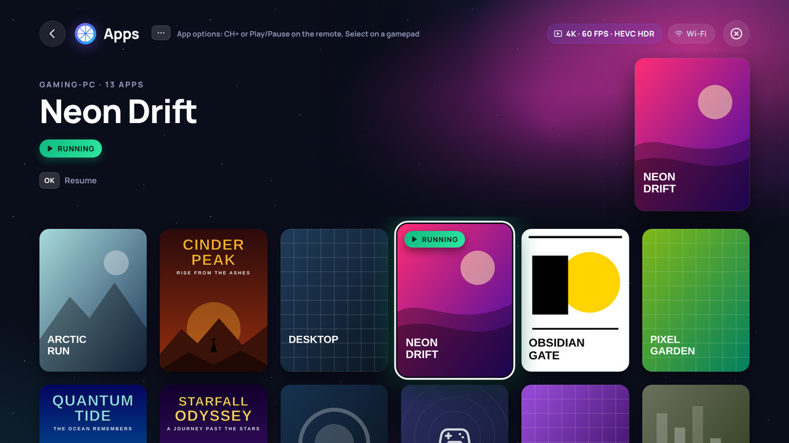

# Moonlight Plus

Moonlight Plus is an unofficial fork of [Moonlight Tizen](https://github.com/brightcraft/moonlight-tizen) by brightcraft. Like Moonlight Tizen, it streams games, programs or the whole desktop from your PC to a Samsung Smart TV, with [Sunshine](https://github.com/LizardByte/Sunshine) on the PC. It is based on Moonlight Tizen 1.19.0 and adds settings that adapt to your TV, clearer messages and many fixes.

> [!NOTE]
>
> Moonlight Plus is not made or supported by the Moonlight Tizen project, the Moonlight project or Samsung. Please report problems with Moonlight Plus on the [issue tracker of this fork](https://github.com/Emperior90/moonlight-tizen-Plus/issues), not to Moonlight Tizen.

---

## Main improvements

- **A new interface for the TV:** the focused PC or game fills the top of the screen with its name, its state and the keys to press, PC cards show their state at a glance, the box art of a game lights up the screen, and the settings, dialogs and menus have a calmer layout with larger text. It uses its own stroke icons and the Manrope font, and the app is about 760 KB smaller than before, as the icon fonts are gone.
- **Optimal settings for this TV:** one button applies the highest resolution of the panel up to 4K, HEVC, HDR when the TV supports it, and a bitrate for its network connection. A dialog shows what it detected and what it applies.
- **Warnings that match the TV:** frame rates above 60 FPS on 60 Hz panels, decoder levels for 4K above 60 FPS, the bitrate cap of the TV class, the 100 Mbps Ethernet port of most Samsung TVs, H.264 above 1080p, and HDR on a TV that doesn't report it.
- **System information** shows what the app detected: panel, HDR, connection, whether the TV offers the Ultra Low Latency mode, which video codecs its browser reports, the connected controllers, and a report of the last stream with hints in plain language. A [diagnostic log](docs/GUIDE.md#diagnostic-log) of the current and the previous session stays in memory on the TV.
- **Smoother video:** reworked frame pacing, faster error correction, fixes for freezes after packet loss, and decoder level 5.2 for 4K above 60 FPS.
- **Clear messages** instead of frozen or black pictures, e.g. which video format the TV rejected. A stream also ends after 1 minute in the background instead of running on.
- **Controllers:** Select and Start work in the menus, mouse emulation works with several controllers, rumble lasts longer than 5 seconds, a *Controller type sent to the PC* setting, a notice for controllers with a non-standard layout, a [button mapping per controller with stick calibration](docs/CONTROLLERS.md#8-button-mapping-and-stick-calibration), and an [input test](docs/CONTROLLERS.md#9-input-test) that shows every key of the remote and every button of a controller.
- **Audio:** an optional *Audio clock sync* and a faster recovery after dropouts for the Web Audio backend, and a [guide to 5.1 surround sound with a soundbar](docs/GUIDE.md#surround-sound-with-a-soundbar).
- **Performance statistics** as one compact line or in full, with session totals, frame intervals and a graph of the last minute that show whether the host, the network or the TV causes a problem, in the corner of the screen you choose.
- **Stream Menu** on Play/Pause or Select + Start: change the bitrate during the game (the stream reconnects with it), type text on the PC with the keyboard of the TV, send keys such as Alt + Tab, and disconnect.
- **App list:** favorites first with a star, sorted A to Z, Z to A, by the recently played or as the host lists them, box art that never holds up the start of a game, and clear hints for the permissions and control tiles of [Apollo and Vibepollo](docs/GUIDE.md#apollo-and-vibepollo).
- **Update check** that reads the releases of this fork.
- **Languages:** the interface follows the language of the TV (German also on Austrian and Swiss TVs, Spanish also in Mexico and the rest of the Americas, French also in Canada, Belgium and Switzerland, Portuguese also in Portugal) and can be chosen in Settings → UI Settings: English, German, Spanish, French and Brazilian Portuguese. How to keep the translations complete: [Translating](docs/TRANSLATING.md).

What changed in each version, in short: [patch notes](docs/PATCH_NOTES.md). Every detail: [changelog](CHANGELOG.md).

*Screenshots of a simulated TV with made-up PCs and generated box art.*

---

## Requirements

- **TV:** a Samsung Smart TV with Tizen 5.5 or newer (model year 2020 or later).
- **Host:** a PC with [Sunshine](https://github.com/LizardByte/Sunshine) and a GPU with a hardware video encoder.
- **Network:** the host PC on a cable, the TV on 5 GHz Wi-Fi or Ethernet. Most Samsung TVs have a 100 Mbps Ethernet port, so Wi-Fi allows higher bitrates.
- **Controller (optional):** see [Controllers](docs/CONTROLLERS.md).

---

## Installation

Download the file from the [releases page of this fork](https://github.com/Emperior90/moonlight-tizen-Plus/releases). Take the release marked *Latest*. Pre-releases are test builds. The [patch notes](docs/PATCH_NOTES.md) say what each version changed.

| Your TV | File |
|---|---|
| Tizen 9.0 or newer | `Moonlight-ForceGM.wgt` |
| Tizen 5.5 to 8.0 | `Moonlight.wgt` |

The ForceGM variant asks the TV for its Game Mode. Keep the *Game mode* switch of the app off with it.

Install the file with a method that works for Moonlight Tizen, e.g. **Apps2Samsung** (*Custom WGT File*) or **Tizen Studio**, as described in the [Installation Guide of Moonlight Tizen](https://github.com/brightcraft/moonlight-tizen/wiki/Installation-Guide). Its Docker method installs the regular Moonlight app from the image of Moonlight Tizen, not Moonlight Plus. The [guide](docs/GUIDE.md#3-installation) has the steps.

Moonlight Plus installs **next to** the regular Moonlight app, with its own settings and its own pairing. Pair your PC once on the first start, even if the regular Moonlight app is already paired.

> [!IMPORTANT]
>
> The earlier release v1.19.0-s90c.1 of this fork (*Moonlight S90C*) checks the releases of Moonlight Tizen for updates, so it will never offer Moonlight Plus. An update that it announces is a release of the regular Moonlight Tizen app, which installs as a separate app. Install the latest Moonlight Plus once by hand from the releases of this fork. It installs over the earlier release.

---

## Documentation

- [Guide](docs/GUIDE.md): installation, the optimal settings, finding your bitrate, System information, performance statistics, host settings, HDR, audio, known limits and troubleshooting
- [Controllers](docs/CONTROLLERS.md): supported controllers, modes, buttons, controller type, rumble and mouse emulation
- [Patch notes](docs/PATCH_NOTES.md): what changed in each version, in short, with every detail in the [changelog](CHANGELOG.md)
- [Translating](docs/TRANSLATING.md): the languages of the app, the rules and the German, Spanish and French glossaries for translators, and how to add a text or a language
- [Tested S90C profile](docs/profiles/S90C/S90C-Optimierungsplan.md): the archived German tuning guide of the Samsung S90C, the model this fork was first tuned on

---

## Support

Open an issue on the [issue tracker of this fork](https://github.com/Emperior90/moonlight-tizen-Plus/issues/new/choose). Please add a photo of Settings → About → *System information*, your host GPU and the controller you use. The [troubleshooting section](docs/GUIDE.md#14-troubleshooting) of the guide explains the common messages.

---

## Development

- Build: the [Development Guide of Moonlight Tizen](https://github.com/brightcraft/moonlight-tizen/wiki/Development-Guide) applies. A release or development build of the `Dockerfile` needs `--build-arg REPO_OWNER=<owner> --build-arg REPO_NAME=<repo>`, the repository whose releases the in-app update check reads.
- Tests: `npm test --prefix tests` runs the tests without a TV (see [tests/README.md](tests/README.md)).
- Upstream: the workflow *Check upstream dependencies* (run it from the Actions tab) lists the changes of Moonlight Tizen, moonlight-common-c, ENet, Opus, libgamestream and Sunshine that are newer than the reviewed state in [dependency-baselines.json](.github/dependency-baselines.json), in one issue with compare links. That file records each upstream change as taken or skipped, with the reason.
- Contributing: see [CONTRIBUTING](.github/CONTRIBUTING.md).

---

## About Moonlight Tizen

Moonlight Tizen is a port of [Moonlight ChromeOS](https://github.com/moonlight-stream/moonlight-chrome), an open-source client for NVIDIA GameStream and Sunshine. Its history, as told in the README of Moonlight Tizen:

- It started as a WebAssembly port for Tizen TVs by the [Samsung Developers Forum](https://github.com/SamsungDForum/moonlight-chrome), which replaced the Native Client module with WebAssembly and used the Tizen WASM Player for hardware-accelerated video and audio (see their [article](https://developer.samsung.com/smarttv/develop/extension-libraries/webassembly/game-streaming-on-tizen-tv-with-wasm.html)).
- [KyroFrCode](https://github.com/KyroFrCode/moonlight-chrome-tizen) turned it into an installable Tizen application.
- In September 2023, brightcraft started a fork, which became the standalone repository [brightcraft/moonlight-tizen](https://github.com/brightcraft/moonlight-tizen), with a new logo, refactored code, updated libraries and many new features.

To support the developer of Moonlight Tizen or to get help with the regular Moonlight app, see the [README of Moonlight Tizen](https://github.com/brightcraft/moonlight-tizen#readme).

---

## License

Moonlight Plus is licensed under the `GNU General Public License v3.0`, like Moonlight Tizen. See the [LICENSE](LICENSE) file for more information. Each release links the commit it was built from, which is its source code.

---

## Credits

Moonlight Plus builds on the work of everyone who made Moonlight Tizen possible. The [contributors of Moonlight Tizen](https://github.com/brightcraft/moonlight-tizen/graphs/contributors?all=1):

The special thanks of the README of Moonlight Tizen:

- [Moonlight Game Streaming Project](https://github.com/moonlight-stream) — for creating the core Moonlight implementation, adapting the NVIDIA GameStream protocol, and developing the Moonlight Chrome OS client. The project's open-source work made it possible to bring Moonlight streaming support to additional platforms and serves as the foundation for the entire Tizen port.
- [Samsung Developers Forum](https://github.com/SamsungDForum/moonlight-chrome) — for creating the first Tizen OS (WASM) adaptation based on the Moonlight Chrome OS client. Their work made Moonlight available on Samsung Smart TVs by integrating the client with Tizen's WASM environment, including video and audio playback through Tizen WASM Player, platform-specific adjustments, and the initial groundwork required for running Moonlight on Tizen devices.
- [KyroFrCode](https://github.com/KyroFrCode/moonlight-chrome-tizen) — for further developing the Tizen implementation by introducing improvements such as a dedicated application build method, 1440p resolution support, a shortcut combo to stop the streaming session, and audio volume control using the remote. This codebase served as the starting point of Moonlight Tizen, which brightcraft later continued as a standalone repository.
- [OneLiberty](https://github.com/OneLiberty/moonlight-chrome-tizen) — for expanding the Tizen implementation in their fork with features such as video codec selection, mouse emulation using the gamepad, Wake-on-LAN (WoL), a new IP address input mode, and other improvements. These changes served as a foundation that was later adapted, improved, and integrated into Moonlight Tizen.
- [toypoodlegaming](https://github.com/toypoodlegaming/moonlight-chrome-tizen) — for further expanding the functionality in their fork with features such as 5.1 and 7.1 surround sound configuration, performance statistics, and enhanced bitrate calculation. These changes served as a foundation that was later adapted, improved, and integrated into Moonlight Tizen.
- [eduardomozart](https://github.com/eduardomozart) — for contributing to the project with localization support featuring Tizen-first locale detection, HTTP subnet scanning, IPv6 and DNS hostname support, custom port support, Smart Hub Preview support, and build optimizations, along with numerous fixes and improvements that were further refined and integrated into the application.
- [fophillips](https://github.com/fophillips) — for contributing to the project by integrating the Web Audio backend implementation from [ruanformigoni](https://github.com/ruanformigoni) alongside the existing EMSS backend, with an Audio Backend selection setting for switching between the two renderers.

Translations of Moonlight Plus:

- German: translated for Moonlight Plus; about half of the texts are based on the German translation of [fidoboy's fork moonlight-tizen-ac3](https://github.com/fidoboy/moonlight-tizen-ac3) (GPL-3.0), rewritten in the informal *du*.
- Spanish: about 340 texts are based on the Spanish translation of [Moonlight Tizen](https://github.com/brightcraft/moonlight-tizen) by brightcraft (`wasm/static/locales/es-ES.json`, GPL-3.0), adapted to the terms of this app; the others are translated for Moonlight Plus.
- French: about 340 texts are based on the French translation of [fidoboy's fork moonlight-tizen-ac3](https://github.com/fidoboy/moonlight-tizen-ac3) (GPL-3.0), adapted to the terms of this app; the others are translated for Moonlight Plus.
- Brazilian Portuguese: from Moonlight Tizen (brightcraft and its contributors), completed for Moonlight Plus.
