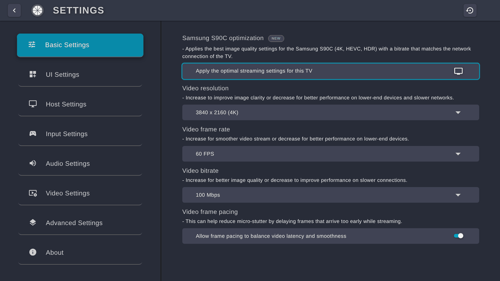
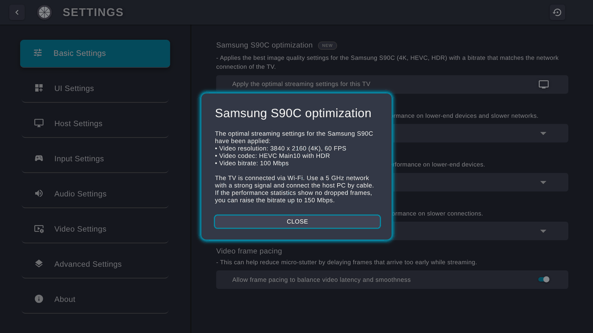
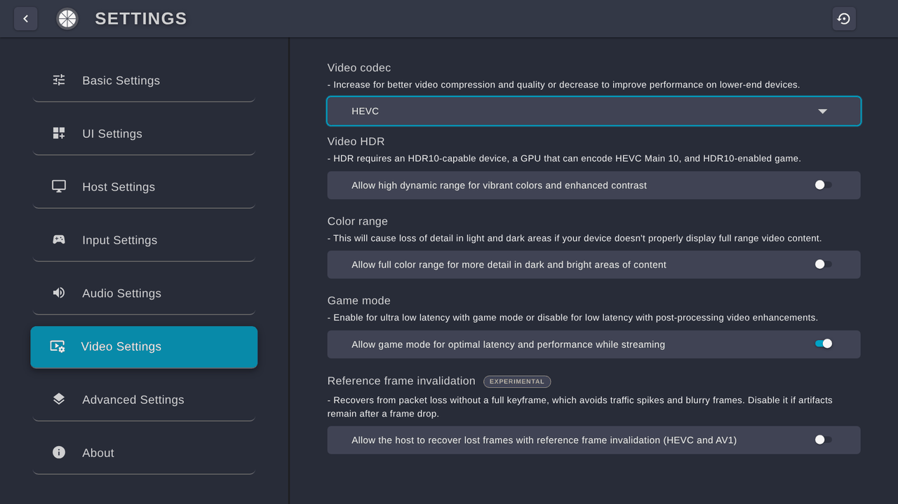

# Moonlight Tizen – Optimierungsplan für den Samsung S90C (55")

Ziel: **Bestmögliche Bildqualität und Auflösung bei hoher Bitrate, ohne Ruckler, Bildfehler oder Verbindungsabbrüche** – speziell für den Samsung S90C (55", QD-OLED, 2023).

Dieses Dokument beschreibt:

1. was der S90C technisch kann (und was nicht),
2. wo bei hohen Bitraten die echten Engpässe liegen,
3. welche Ziel-Konfiguration daraus folgt,
4. was im Netzwerk, am PC (Sunshine/Apollo) und am TV einzustellen ist,
5. was in dieser App-Version geändert wurde,
6. wie man Schritt für Schritt testet, bis der Stream fehlerfrei läuft.

> [!NOTE]
> Der allgemeine Teil (Abschnitte 1–9) deckt beide Varianten ab (TV per LAN oder per WLAN). Die Auswertung deines konkreten Setups (Stand 20.10.2026: RTX 5080, Sunshine, FRITZ!Repeater als LAN-Brücke am TV, Tizen 9) steht in **[Abschnitt A](#a-auswertung-deines-setups-stand-20102026)** direkt nach der Kurzfassung.

---

## 0. Kurzfassung

**Empfohlenes Zielprofil für den S90C:**

| Einstellung | TV per WLAN (5 GHz) | TV per LAN |
|---|---|---|
| Auflösung | 3840 × 2160 (4K) | 3840 × 2160 (4K) |
| Bildrate | 60 FPS | 60 FPS |
| Codec | HEVC Main10 mit HDR (alternativ AV1, wenn die GPU es kann) | HEVC Main10 mit HDR |
| Bitrate | Start 100 Mbit/s, Test bis 150 Mbit/s | 75 Mbit/s (max. 80), **nur mit Burst-Fix** (Abschnitt 4.1) |
| Frame Pacing | an | an |
| Game Mode | Tizen 7/8: an · Tizen 9+: aus, dafür die ForceGM-Variante | wie links |
| Farbbereich | begrenzt (Standard) | begrenzt (Standard) |

**Die fünf wichtigsten Hebel, nach Wirkung sortiert:**

1. **Netzwerk:** Der LAN-Port des S90C schafft nur **100 Mbit/s**. Über LAN entweder die Bitrate auf ~75 Mbit/s begrenzen *und* die Datenbursts des PCs glätten, oder für höhere Bitraten **5-GHz-WLAN** nutzen.
2. **60 statt 120 FPS:** Tizen-Apps werden auf vielen Modellen nur mit ~60 FPS dargestellt. Bei gleicher Bitrate bekommt jedes Bild bei 60 FPS doppelt so viele Bits, das ergibt sichtbar bessere Bildqualität.
3. **HEVC Main10 (HDR) in 4K**, H.264 nur bis 1080p (der Samsung-Decoder kann H.264 praktisch nur bis Level 4.2).
4. **Encoder am PC** mit Qualitäts-Reserve: NVENC-Preset P4–P6 statt P1, aber nur solange der Encoder nicht ausgelastet ist.
5. **Messen statt raten:** Statistik-Overlay einschalten. Die neuen **Sitzungszähler** müssen über eine ganze Spielsession bei 0 bleiben.

**Für niedrige Latenz** kommen vier Hebel dazu: der Spielmodus des TVs (ForceGM-Variante), Frame Generation aus, *Split Frame Encoding* in Sunshine und ein kleinerer Audio-Puffer. Die ganze Kette mit deinen Werten steht in [Abschnitt A.8](#a8-dein-ziel-4k60-optional-mehr-beste-bildqualität-niedrige-latenz).

In der App erledigt der neue Button **Settings → Basic Settings → „Samsung S90C optimization“** das alles mit einem Klick. Die Bitrate passt er an die erkannte Verbindung (LAN/WLAN) an. (Die App-Oberfläche ist englisch, deshalb stehen die Menünamen hier im Original.)

---

## A. Auswertung deines Setups (Stand 20.10.2026)

Kurz gesagt: **Dein Netzwerk ist sehr gut, die PC-Einstellungen sind auf Qualität getrimmt. Das Ruckeln nach ~2 h liegt sehr wahrscheinlich am PC. Den Hardware-Decoder des TVs kann keine App schneller machen, aber die App kann ihm unnötige Konkurrenz auf dem TV ersparen. Was diese Version dafür ändert, steht in [Abschnitt A.7](#a7-mehr-leistung-aus-dem-tv-für-4k-mit-hoher-bitrate).**

### A.1 Frame Pacing: nicht die Ursache der Ruckler, aber wichtig für die Latenz

Laut deiner Erfahrung war das Frame Pacing bei den Rucklern nicht das Problem, die sind seit Version 1.18 behoben. Für dein Latenz-Ziel ist aber ein Wert aus deinem Overlay wichtig: *Average decoding time* 50–72 ms bei 1440p (Version 1.18). Das war nicht die Dekodierzeit, sondern die Zeit vom Empfang eines Bildes bis zur Übergabe an den Decoder, also Wartezeit am TV, die direkt zur Latenz zählt. Davon entfielen ~15 ms auf das Pacing selbst (*Average frame queue delay*), den Rest warteten die Bilder in der Warteschlange davor.

Die Ursache steht im Code von Version 1.18/1.19: Der Pacer hat seinen Takt einmal pro Sekunde an dem einen Bild ausgerichtet, das das Zeitfenster abschloss, und dabei die Wartezeit in der eigenen Warteschlange mitgemessen. Kam dieses Bild verspätet, hielt er danach alle Bilder um diese Zeit zurück und baute das nur um 0,5 ms pro Sekunde ab. Das erzeugt keine Ruckler, aber dauerhafte Verzögerung.

Diese Version richtet den Takt am *typischen* Ankunftszeitpunkt der Bilder aus (Median plus dreifache robuste Streuung, gedeckelt auf eine halbe Frame-Dauer) und misst ab dem Eintreffen eines Bildes. Einen Anstieg des Takts übernimmt sie erst, wenn zwei aufeinanderfolgende Zeitfenster ihn bestätigen: Nach einem WLAN-Stall von über einer halben Sekunde kommen die aufgestauten Bilder als Schwall an und würden sonst das nächste Zeitfenster um bis zu mehrere hundert Millisekunden zurückhalten (bei 120 FPS läuft dabei die Warteschlange über, Folge wäre ein Recovery-Keyframe). Ein Rückgang gilt sofort. In meiner Simulation (10 min, 60 und 120 FPS) sank die Zusatzverzögerung in den Szenarien mit WLAN-Aussetzern deutlich, und bei normalem Jitter lief die Bildfolge gleichmäßiger. Nur bei sehr häufigen großen Aussetzern ruckelte sie etwas mehr.

**Was du nach dem Update sehen solltest:** Das Overlay trennt die Wartezeit jetzt in ihre Stufen (siehe „So liest man das Overlay“ in Abschnitt 8): *Average frame wait time* (fertig empfangenes Bild wartet auf den Video-Thread) sollte bei wenigen Millisekunden liegen, *Average frame pacing delay* (bewusste Wartezeit des Pacers) ebenfalls, und *Pending frames* bei 0–1. Zusammen entsprechen sie der alten *Average decoding time*, die bei dir 50–72 ms betrug. Frame Pacing bleibt abschaltbar (A/B-Test in Phase 3).

### A.2 Netzwerk: sehr gut, kleine Feinheiten

- **FRITZ!Repeater 1200 AX als LAN-Brücke direkt am TV** ist für den S90C die beste Lösung: Kabel-Backhaul, kurze Funkstrecke, 5 GHz. Deine 0,00 % Verlust und 1–3 ms bestätigen das.
- **„120 Mbit/s eingestellt, 108 kommen an“ ist kein Verlust.** Die Anzeige *Incoming bitrate* zählt nur die Videodaten. Sunshine zieht von der eingestellten Bitrate deine 5 % FEC, Audio und Overhead ab (120 × 0,95 − ~1 ≈ 113 Mbit/s Encoder-Ziel), und im Durchschnitt liegt der Encoder etwas darunter.
- **Prüfen, ob der TV wirklich am Repeater hängt:** FRITZ!Box → Heimnetz → Mesh. Der TV sollte unter dem Repeater erscheinen. Mesh Steering kann ein Gerät zwischen Box und Repeater wechseln lassen, und jeder Wechsel ist ein kurzer Aussetzer.
- **Kanäle:** Funken FRITZ!Box und Repeater beide in 36–48, teilen sie sich die Funkzeit. Wenn möglich, die Box auf einen anderen 5-GHz-Block legen (z. B. 100+) und den Repeater auf 36–48 lassen. Außerdem einen **festen Kanal** statt Autokanal wählen, damit nicht mitten in der Session gewechselt wird.
- **FRITZ!Box-Ereignisprotokoll** (System → Ereignisse, Filter WLAN): Direkt nach dem nächsten 2-h-Ruckeln nachsehen, ob der TV sich ab-/angemeldet hat oder der Kanal gewechselt wurde.
- Die Priorisierung als „Echtzeitanwendung“ wirkt nur auf Internet-Verkehr, nicht auf PC → TV im Heimnetz. Sie schadet aber nicht.
- **FEC 5 %:** in Ordnung, solange die neuen *Session*-Zähler über lange Sessions bei 0 bleiben. Tauchen dort Drops auf, auf 10 % erhöhen.

### A.3 Das Ruckeln nach ~2 h: wahrscheinlich der PC

Gegen Netzwerk und TV spricht: 0 % Verlust, der Web-Audio-Scheduler fängt Uhrendrift sauber ab, und in der Simulation kippt das Pacing auch nach einem einzelnen großen Aussetzer nicht dauerhaft. Für den PC sprechen mehrere Punkte, die über Stunden zusammenkommen:

1. **VRAM am Limit:** 4K + Raytracing + Frame Generation + DLSS + NVENC (4K HDR, Two-Pass Full) auf 16 GB. Die Sunshine-Doku warnt ausdrücklich: Mit **HAGS + „Realtime HAGS“ + fast vollem VRAM** kann der NVIDIA-Encoder hängen. Zu Witcher 3 (Next-Gen, DX12) gibt es zudem Berichte, dass die VRAM-Belegung mit Raytracing in langen Sessions stetig wächst und es ab ~95 % Auslastung zu starken Rucklern kommt ([WCCFtech](https://wccftech.com/the-witcher-3-next-gen-new-mod-fixes-ray-tracing-memory-leak-issues-increases-performance/amp/), [Community-Mod dazu](https://www.nexusmods.com/witcher3/mods/12493)). Das passt genau zu „läuft gut, nach ~2 h Ruckeln“. Offiziell bestätigt ist es nicht, ein Neustart des Spiels hilft laut den Berichten.
2. **Frame Generation 2x bei 60 Hz:** Damit rendert das Spiel intern nur 30 FPS. Das bedeutet mehr Eingabeverzögerung, mehr FG-Artefakte und zusätzlichen VRAM-Bedarf. Eine RTX 5080 schafft Witcher 3 mit Raytracing (ohne Path Tracing) in 4K mit DLSS Super Resolution (Balanced/Performance mit dem neuen Modell) sehr wahrscheinlich auch ohne FG mit stabilen 60 FPS.
3. **Übertaktung:** Undervolt 950 mV bei 3000–3050 MHz und VRAM +1000 MHz sind ambitioniert. GDDR7 korrigiert Speicherfehler bei Wärme oft still, was sich erst nach längerer Zeit als Ruckeln bemerkbar macht.

**Gezielter Test (je eine Änderung pro 2-h-Session):**

| Test | Erwartung, wenn das die Ursache ist |
|---|---|
| A) **Frame Generation aus**, DLSS SR Balanced/Performance, V-Sync (60 Hz) wie bisher | Kein Ruckeln nach 2 h, dazu spürbar direkter |
| B) **VRAM-Übertaktung auf 0** (Undervolt behalten) | Kein Ruckeln nach 2 h |
| C) In Sunshine **„Realtime HAGS“ aus** | Kein Ruckeln nach 2 h (kostet unter Last etwas Capture-Leistung) |
| D) Spiel nach ~90 min neu starten | Ruckeln verschwindet, also wächst der Speicher des Spiels |

**Wenn es wieder ruckelt, sofort das Overlay einblenden und notieren:**

| Beobachtung | Ursache |
|---|---|
| *Incoming frame rate* < 60, Netzwerk-Drops 0, *Host processing latency* (max) hoch | PC: Spiel/Encoder. Mit **HWiNFO** über die Session VRAM-Belegung, GPU-Hotspot, Speichertemperatur und Takt mitloggen |
| *Session frames dropped by network* / *Session recovery keyframes* steigen | WLAN: FRITZ!Box-Ereignisprotokoll prüfen |
| *Incoming* 60, aber *Rendering* < 60 oder *Average frame wait time* / *Pending frames* steigen | TV-seitig: App neu starten, Ergebnis notieren |

### A.4 Sunshine: Einstellungen passen, mit Anmerkungen

- **P6 + Two-Pass Full:** sinnvoll für maximale Qualität. 11 ms bei 4K liegen unter den 16,7 ms pro Bild, zählen aber voll zur Latenz. Für dein Latenz-Ziel deshalb *Split Frame Encoding: Enabled* setzen: Die RTX 5080 hat zwei Encoder, die sich dann jedes Bild teilen. Laut Sunshine-Doku verkürzt das die Kodierzeit deutlich, bei minimalem Qualitätsverlust. Liegt das *Maximum* der Host processing latency danach trotzdem regelmäßig über ~14 ms, *Two-Pass: Quarter resolution* testen.
- **VBV-Erhöhung 0:** der sichere Startwert. Für mehr Qualität in schnellen Szenen über dein WLAN 50 bzw. 100 testen (A.8). **Spatial AQ aus:** richtig bei hohen Bitraten.
- *Minimale CPU-Threads*, *QP* und *CAVLC* wirken bei NVENC-HEVC mit Bitratensteuerung nicht. Die kannst du ignorieren.
- **Version:** v2026.914.233613 konnte ich nicht verifizieren. Öffentlich auffindbar war zuletzt v2026.724.x, und auf die GitHub-Releases hatte ich keinen Zugriff. Deine installierte Version zeigt die Sunshine-Weboberfläche. Die aktuelle stabile Version steht auf github.com/LizardByte/Sunshine/releases.

### A.5 Moonlight am TV

- **Update auf diese Version** (1.19.0 + S90C-Änderungen): Sie bringt die Leistungsoptimierungen aus A.7, die Session-Zähler und die BT.709-Farben. Achtung: Der Button „Samsung S90C optimization“ stellt *Color range* auf „begrenzt“. Bewusst so, siehe nächster Punkt.
- **Full color range:** Nur behalten, wenn ein Schwarzwert-Test das bestätigt. Erkennt der TV den vollen Bereich nicht korrekt, saufen dunkle Details ab und helle clippen. Das wirkt „knackiger“, kostet aber Zeichnung in dunklen Szenen, und davon hat Witcher 3 viele. Test: eine Near-Black-Testseite oder der HDR-Kalibrierungsbildschirm des Spiels, einmal mit „Full“, einmal mit „Limited“. Gewinner ist die Einstellung, bei der die dunkelsten Stufen gerade noch unterscheidbar sind.
- **Bitrate 4K/95 Mbit/s** ist ein guter Wert, nahe an Samsungs Decoder-Spezifikation. Optional 4K mit 110 Mbit/s 30 Minuten lang testen und dabei auf die Session-Zähler, *Average frame wait time* und *Average rendering time* achten.
- **4K vs. 1440p bei 3 m Abstand:** Ein 4K-Pixel ist auf 55" aus 3 m nur ~0,36 Bogenminuten groß, ein 1440p-Pixel ~0,55. Das menschliche Auge löst grob 0,5–1 Bogenminute auf. Aus deinem Abstand ist 1440p also nah an der Wahrnehmungsgrenze, und 1440p mit 120 Mbit/s hat pro Pixel rund dreimal so viele Bits wie 4K mit 95 Mbit/s. In dunklen, detailreichen Szenen (Vegetation, Nebel) kann 1440p deshalb sauberer wirken, 4K punktet bei feinen Kanten. Ein direkter Vergleich aus 3 m lohnt sich.
- **Web Audio mit 100 ms:** ein sicherer Wert. Für weniger Ton-Verzögerung nach diesem Update 75, dann 50 ms testen (A.8). Bei Aussetzern wieder erhöhen.

### A.6 TV-Einstellungen

| Einstellung | Bei dir | Empfehlung |
|---|---|---|
| Kontrastverbesserung | prüfen | **Aus** (verbiegt die Tonwertkurve dynamisch) |
| Schärfe | 5 | **0 bei 4K** (natives Bild, keine künstlichen Kanten). Bei 1440p sind 3–5 in Ordnung |
| Bildmodus | Film | Für Genauigkeit gut. Höhere TV-interne Latenz als der Spielmodus (siehe unten) |
| HDR-Tone-Mapping | Statisch | Gut. Dazu die **Windows-HDR-Kalibrierung über den Stream** am TV durchführen (Muster jeweils gerade verschwinden lassen), damit Spiel und TV dieselbe Spitzenhelligkeit annehmen |
| Farbton Warm 2, Spitzenhelligkeit Hoch, Bewegungsglättung/Clear Motion/Rauschunterdrückung aus | ✓ | passt |

**Optionaler Latenz-Test:** Die **ForceGM-Variante** schaltet den TV in den Spielmodus (deutlich weniger Verarbeitungslatenz als „Film“). Laut Projekt-Wiki gibt es unter Tizen 9 je nach Modell Probleme oberhalb von 1080p. Deshalb gezielt testen, ob 4K damit sauber läuft. In der App bleibt *Game mode* dabei aus.

### A.7 Mehr Leistung aus dem TV für 4K mit hoher Bitrate

**Was die App beeinflussen kann und was nicht:** Das eigentliche Dekodieren übernimmt der Hardware-Decoder des TVs, und den kann keine App beschleunigen. Bei 4K60 mit ~100 Mbit/s arbeitet er nahe an Samsungs Spezifikation. Die App kann aber dafür sorgen, dass auf dem TV nichts Unnötiges mit dem Stream konkurriert. Drei Stellen sind dafür entscheidend:

- der **Haupt-Thread** des Browsers: Er plant mit *Web Audio* jeden Audio-Frame ein. Ist er blockiert, gibt es Aussetzer.
- der **Video-Thread**, der jedes Bild an den TV-Player übergibt,
- der **WLAN-Uplink** vom TV zum PC, der sich die Funkzeit mit dem Videostrom teilt.

An diesen Stellen habe ich im Code fünf unnötige Lasten gefunden. Diese Version beseitigt sie:

| # | Vorher | Jetzt | Wirkung |
|---|---|---|---|
| 1 | Die Menü-Navigation hat das Gamepad **auch während des Streams** alle 5 ms abgefragt. Auf dem Haupt-Thread hieß das jedes Mal `navigator.getGamepads()` und ein Vergleich aller Tasten, dazu neue Objekte und bei jeder Stick-Bewegung ein Event. | Pausiert während des Streams und läuft beim Zurückkehren ins Menü wieder an. Tasten, die beim Stream-Ende noch gehalten werden, lösen dabei nichts aus. | ~200 Aufgaben pro Sekunde auf dem Haupt-Thread fallen weg, ebenso der Speichermüll daraus. |
| 2 | Die Stream-Eingabe hat pro 5-ms-Takt **2 + 4 synchrone Aufrufe** über den Haupt-Thread gebraucht (Chromium meldet 4 Gamepad-Plätze). | **Ein** gebündelter Aufruf pro Takt, mit Rückfall auf den alten Weg. | 200 statt ~1.200 Haupt-Thread-Aufrufe pro Sekunde. Der Eingabe-Thread wartet seltener. |
| 3 | Der Controller-Zustand ging **200-mal pro Sekunde** als verschlüsseltes, zuverlässiges Paket an den PC, auch wenn er sich nicht geändert hatte. | Wird nur bei einer Änderung gesendet, dazu alle 100 ms eine Auffrischung. Ein verworfenes Paket wird beim nächsten Takt wiederholt. | Bei ruhendem Controller 10 statt 200 Pakete pro Sekunde. Das spart Funkzeit im WLAN-Uplink, ENet-Bestätigungen und CPU. |
| 4 | Mit eingeschaltetem Overlay hat der **Video-Thread einmal pro Sekunde auf den Haupt-Thread gewartet**, um die Statistik zu übergeben. | Wird übergeben, ohne zu warten. | Der Video-Thread stockt nicht mehr, wenn der Haupt-Thread gerade beschäftigt ist. |
| 5 | Kompiliert mit `-Os` (auf Dateigröße optimiert). | Kompiliert mit `-O2` (auf Geschwindigkeit optimiert). | Schnellerer Code in den heißen Pfaden (Paketverarbeitung, Opus). Die Datei wird etwas größer. |

Geprüft, aber unverändert gelassen: Der Video-Empfang ist bereits gut eingestellt (blockierender Socket, angeforderter Empfangspuffer ~2,9 MB, Paketgröße 1392 Byte, keine Video-Verschlüsselung). Das Host-Polling pausiert während des Streams schon. Logausgaben laufen nicht über den Haupt-Thread. Rumble-Meldungen kommen über einen eigenen Thread, der sie beim Warten zusammenfasst.

**Ehrliche Einordnung:** Den Decoder macht keine dieser Änderungen schneller, und auf einem echten TV habe ich nichts gemessen. Ich erwarte vor allem weniger Spitzen, also weniger Audio-Aussetzer mit *Web Audio*, eine gleichmäßigere Übergabe der Bilder und weniger Konkurrenz im WLAN. Ob das für 4K über 95 Mbit/s reicht, zeigt erst der Test.

**So testest du es** (4K60, HEVC, sonst alles wie bisher):

1. Bitrate-Leiter **95 → 110 → 120 Mbit/s**, je 20 Minuten im selben anspruchsvollen Spiel, Overlay an.
2. **Bestanden**, wenn *Session frames dropped by network* und *Session recovery keyframes* bei 0 bleiben, die *Rendering frame rate* stabil bei 60 liegt und der Ton nicht aussetzt.
3. **Bei Audio-Aussetzern** einmal *Audio backend: EMSS* testen. EMSS übergibt den Ton direkt aus dem Audio-Thread an den TV-Player und braucht den Haupt-Thread dafür nicht.
4. Steigt die *Average rendering time* (Übergabe eines Bildes an den TV-Player) mit der Bitrate deutlich an, ist der Decoder-Pfad des TVs am Limit. Dann eine Stufe zurückgehen.

### A.8 Dein Ziel: 4K60 (optional mehr), beste Bildqualität, niedrige Latenz

#### Latenz: die ganze Kette

Die Verzögerung zwischen Tastendruck und Bild setzt sich aus mehreren Gliedern zusammen. Nach Größe sortiert, mit deinen aktuellen Einstellungen:

| Glied | Bei dir jetzt | Hebel | Gewinn (grob) |
|---|---|---|---|
| Bildverarbeitung des TVs | Bildmodus „Film“, ohne Spielmodus | **ForceGM-Variante**, die den Spielmodus des TVs einschaltet. Unter Tizen 9 bei 4K gezielt testen (A.6) | Laut RTINGS-Messungen an anderen TVs (HDMI-Eingang) liegt die Verzögerung außerhalb des Spielmodus typischerweise bei 60–80 ms statt ~10 ms. Für den S90C und für die Wiedergabe in Apps habe ich keine Messwerte gefunden, die Größenordnung dürfte ähnlich sein |
| Frame Generation 2x | Das Spiel rendert intern nur 30 FPS | **FG aus**, DLSS Super Resolution (Balanced/Performance), **Reflex an** | Grob 30–50 ms: FG hält ein internes Bild (~33 ms) zurück, und 30 FPS reagieren träger als 60 |
| Wartezeit am TV vor dem Decoder | *Average decoding time* 50–72 ms (1440p, Version 1.18) | **Diese Version** (neues Frame Pacing, A.1). Für das absolute Minimum Frame Pacing aus (A/B-Test) | Bis zu mehrere Dutzend Millisekunden. Das Overlay zeigt es jetzt getrennt als *Average frame wait time* und *Average frame pacing delay* |
| Encoder am PC | ~11 ms bei 4K (P6, Two-Pass Full) | ***Split Frame Encoding: Enabled***: Beide NVENC-Einheiten der RTX 5080 teilen sich jedes Bild | Laut Sunshine-Doku deutlich kürzere Kodierzeit bei minimalem Effizienzverlust. Die *Host processing latency* im Overlay zeigt es |
| Ton | Web Audio mit 100 ms Jitter-Puffer | **Puffer auf 50–75 ms** senken. Nach diesem Update ist der Haupt-Thread entlastet. Bei Aussetzern wieder erhöhen | Der Ton läuft etwa um den Pufferwert hinter dem Bild. Geht die Uhr des PCs etwas schneller als die des TVs, wächst der Abstand im Lauf der Session bis zum 1,5-Fachen, bei 100 ms also bis 150 ms. Die neue Option *Audio clock sync* (A/B-Test in Phase 3) hält ihn stattdessen am Pufferwert |
| Netzwerk | 1–3 ms | nichts zu tun | – |

Im Spiel außerdem eine **Bildratenbegrenzung auf 60 FPS** setzen (Abschnitt 5.3), wenn die GPU sonst dauerhaft am Anschlag läuft. Das hält die Render-Warteschlange kurz und lässt dem Encoder GPU-Reserve.

#### Bildqualität im Stand und in Bewegung

**Im Stand** ist mit 4K60, HDR10 (Main10) und ~100 Mbit/s fast alles ausgereizt. Es bleiben die TV-Einstellungen aus A.6 (Schärfe 0 bei 4K, Kontrastverbesserung aus), der Schwarzwert-Test für *Color range* (A.5) und die Windows-HDR-Kalibrierung. Farbunterabtastung 4:2:0 ist fest: Ein 4:4:4-Stream (Sunshine kann ihn) würde ein HEVC-RExt-Profil brauchen, das TV-Decoder üblicherweise nicht unterstützen.

Ein Punkt kommt neu dazu: **HDR-Metadaten.** Sunshines NVENC-Pfad schreibt keine HDR10-Metadaten (Mastering Display, MaxCLL/MaxFALL) in den Videostrom, sondern schickt sie nur über den Steuerkanal, und die App hat sie bisher verworfen. Der TV sah also nur „BT.2020/PQ“ und musste für das Tone Mapping Standardwerte annehmen. Die neue Option **Settings → Video Settings → HDR static metadata** (experimentell, Standard aus) fügt sie in jedes HEVC-Keyframe ein. Die Werte stammen vom Host-Display, bei dir also vom virtuellen Display (VDD): Dessen HDR-Angaben sollten zur Windows-HDR-Kalibrierung passen (Spitzenhelligkeit um 1.000 Nits für den S90C). Test: Option an, HDR-Stream starten; startet er oder sieht das Bild falsch aus, Option wieder aus. Läuft er, mit dem HDR-Kalibrierungsbild des Spiels prüfen, ob Lichter (Wolken, Sonne) mehr Zeichnung haben.

**In Bewegung** entscheidet, wie viele Bits ein schwieriges Bild bekommen darf:

1. **Bitrate:** 95 Mbit/s bei 60 FPS sind ~1,6 Mbit pro Bild. Mehr Bitrate hilft direkt, also die Bitrate-Leiter aus A.7 durchgehen.
2. **VBV:** Mit `nvenc_vbv_increase = 0` darf kein Bild größer werden als Bitrate ÷ FPS. Genau schnelle Kameraschwenks, Vegetation und Partikel bräuchten mehr. Über dein WLAN, ohne den 100-Mbit-Port im Weg, lohnt ein Test mit **50, dann 100 %**. Größere Bilder brauchen über die Funkstrecke ein paar Millisekunden länger. Tauchen Session-Drops auf, zurück auf 0.
3. **Frame Generation aus:** FG-Zwischenbilder haben bei schnellen Bewegungen eigene Artefakte, die im Stream genauso sichtbar sind.
4. **P6 mit Two-Pass Full** ist für die Qualität richtig. Mit Split Frame Encoding bleibt die Kodierzeit trotzdem niedrig.
5. **Bewegungsschärfe des OLEDs:** Bei 60 Hz verwischt das Auge bewegte Bilder (Sample-and-Hold). Zwischenbildberechnung würde das mildern, kostet aber Latenz. Für dein Ziel bleibt sie aus.

#### 4K120 als Option

Die App ist vorbereitet: Sie meldet dem TV für 4K120 das nötige Codec-Level 5.2, der Sicherheitsabstand des Frame Pacings beträgt bei 120 FPS höchstens ~4 ms, und der Bitrate-Regler geht bis 150 Mbit/s. Dagegen spricht einiges:

- **Darstellung:** Laut Projekt-Wiki begrenzt Tizen die Darstellung von Apps auf vielen Modellen auf ~60 FPS, auch bei einem 120-Hz-Panel.
- **Messbarkeit:** Das Overlay zählt die an den TV-Player übergebenen Bilder, nicht die angezeigten. Eine *Rendering frame rate* von 120 beweist also nicht, dass der TV 120 Bilder zeigt. Prüfen lässt sich das nur mit dem Auge, z. B. mit testufo.com im Browser auf dem PC: im Stream 60 und 120 FPS vergleichen.
- **Bildqualität:** Bei 150 Mbit/s bleiben pro Bild 1,25 Mbit statt ~1,6 Mbit wie bei 4K60 mit 95 Mbit/s. Jedes Einzelbild wird schlechter.
- **PC:** Das virtuelle Display muss auf 120 Hz laufen, und das Spiel muss ohne FG 120 FPS schaffen. Der Encoder muss in 8,3 ms fertig sein, P6 mit Two-Pass Full braucht bei 4K aber ~11 ms. Also Split Frame Encoding an oder das Preset senken.

**Fazit:** 4K60 ist das Hauptprofil für dein Ziel. 4K120 einmal testen und nur behalten, wenn es sichtbar flüssiger ist. Als Mittelweg gibt es jetzt **3200 × 1800 bei 120 FPS**: 69 % der 4K-Pixel, bei 120 Mbit/s mit 0,17 Bit pro Pixel fast so viel wie 4K60 bei 100 Mbit/s (0,20), und der Encoder hat rund 30 % weniger zu tun. Dafür muss das virtuelle Display 3200 × 1800 bei 120 Hz anbieten.

---

## 1. Fakten zum S90C (55")

| Eigenschaft | S90C 55" | Bedeutung für Moonlight |
|---|---|---|
| Panel | QD-OLED, 3840 × 2160, bis 144 Hz | 4K ist die native Auflösung, alles darunter wird hochskaliert |
| HDR | HDR10, HDR10+, HLG (kein Dolby Vision) | Moonlight/Sunshine liefert HDR10 (HEVC/AV1 Main10, PQ) |
| Tizen | Ab Werk Tizen 7.0. Samsung hat das Update auf Tizen 9 für 2023er-Modelle angekündigt, es wird schrittweise verteilt | Ab Tizen 9 ist der Game Mode (Ultra Low Latency) in WASM-Apps problematisch (siehe Abschnitt 6) |
| LAN | **100 Mbit/s** (Fast Ethernet, wie bei Samsung-TVs üblich) | Hartes Limit, inklusive Bursts (Abschnitt 2.1) |
| WLAN | **Wi-Fi 5 (802.11ac)** | Real deutlich mehr als 100 Mbit/s möglich, aber störanfälliger |
| USB | 2 × USB 2.0 | USB-LAN-Adapter werden von Samsung-TVs nicht unterstützt (und wären durch USB 2.0 begrenzt) |
| Video-Decoder | HEVC Main/Main10 und AV1 bis **3840 × 2160 @ 120 fps** (HEVC UHD bis Level 5.2), H.264 bis Level 4.1/4.2 (≈ 1080p) | 4K60 ist sicher, 4K120 läuft im Rahmen der Spezifikation, 4K144 nicht mehr |
| Decoder-Bitrate | Samsung gibt für 4K je nach Modellgruppe grob 80–100 Mbit/s an. Darüber „kann die Wiedergabe stocken“ | Über ~100 Mbit/s bewegt man sich außerhalb der Spezifikation (oft geht es trotzdem, also testen) |
| App-Rendering | Tizen begrenzt die Darstellung von Apps auf vielen Modellen auf ~60 FPS | 120 FPS bringt oft keine flüssigere Darstellung, halbiert aber die Bits pro Bild |

> [!IMPORTANT]
> Die Samsung-Entwicklerseiten waren aus meiner Umgebung nicht direkt abrufbar. Die Decoder-Werte stammen aus Suchergebnissen zur offiziellen Samsung-Tabelle („2023 TV Video Specifications“) und aus dem Wiki des Moonlight-Tizen-Projekts. Die genaue Bitrate-Grenze deiner Modellgruppe findest du auf der Samsung-Seite (Link unten). Am verlässlichsten ist ohnehin der Test nach Abschnitt 8.

---

## 2. Wo die Grenzen wirklich liegen (Engpass-Analyse)

Die Kette sieht so aus:

```
Spiel → GPU-Encoder (NVENC) → Sunshine (+20 % FEC, Pacing ~800 Mbit/s)
      → PC-Netzwerkkarte (1 Gbit/s) → Router/Switch → TV (100 Mbit/s LAN oder Wi-Fi 5)
      → WASM-Empfang + FEC-Rekonstruktion → Hardware-Decoder (EMSS) → OLED-Panel
```

Fehler entstehen fast immer an einer dieser vier Stellen:

### 2.1 Der 100-Mbit-LAN-Port und die Bursts (häufigste Ursache)

- Sunshine schickt jedes Bild als Paket-Burst mit bis zu **~800 Mbit/s** (im Sunshine-Quellcode fest auf 80 % von 1 Gbit/s eingestellt).
- Ein Bild ist bei Sunshines Standard-Einstellung (`nvenc_vbv_increase = 0`) höchstens etwa *Bitrate ÷ FPS* groß, inklusive FEC. Bei 75 Mbit/s und 60 FPS sind das ≈ 1,25 Mbit ≈ **156 KB**.
- Diese 156 KB kommen in ~1,6 ms am Switch an. Der TV-Port leert in dieser Zeit aber nur ~20 KB. Der Switch muss also **~140 KB pro Bild** zwischenspeichern.
- Viele günstige Switches und Router haben insgesamt nur 128–512 KB Puffer, geteilt über alle Ports. Läuft er über, gehen Pakete verloren. Die Folge: Frame-Drops, Freezes, schwarzes Bild. Das passiert, obwohl die *durchschnittliche* Bitrate weit unter 100 Mbit/s liegt.
- Über WLAN tritt das so nicht auf: Der Access Point puffert deutlich mehr, und die Funkstrecke ist schneller als 100 Mbit/s.

**Konsequenz:** Über LAN reicht es nicht, nur die Bitrate unter 100 Mbit/s zu halten. Die Bursts müssen geglättet werden (Abschnitt 4.1).

### 2.2 Bitrate in Moonlight = Gesamtbudget

Sunshine rechnet die in Moonlight eingestellte Bitrate als *Gesamtbudget*: Davon gehen 20 % FEC, Audio und ~0,5 Mbit/s Overhead ab, der Rest geht an den Encoder. Auf dem Kabel landen inklusive IP/UDP/Ethernet-Headern etwa **+5 %**.

- 75 Mbit/s in Moonlight ≈ 79 Mbit/s auf dem Kabel, das passt in 100 Mbit/s mit Reserve.
- 80 Mbit/s ≈ 84 Mbit/s, das ist das sinnvolle Maximum über LAN.
- Bei 100 Mbit/s oder mehr über LAN ist Paketverlust praktisch garantiert.

### 2.3 Bits pro Bild (warum 4K60 die beste Bildqualität liefert)

| Profil | Bits pro Bild bei 100 Mbit/s |
|---|---|
| 4K @ 60 FPS | 1,67 Mbit |
| 4K @ 120 FPS | 0,83 Mbit |

Bei gleicher Bitrate hat 4K60 pro Bild die doppelte Datenmenge. Weil Tizen-Apps auf vielen Modellen ohnehin nur ~60 FPS darstellen, ist **4K60 die beste Wahl für maximale Bildqualität**. 4K120 lohnt sich nur, wenn der TV die 120 Bilder auch zeigt. Das Overlay kann das nicht belegen, denn es zählt die an den Player übergebenen Bilder. Wie man es prüft, steht in A.8.

### 2.4 Decoder-Spezifikation

- Die TV-Pipeline wird mit einem Codec-String inklusive **Level** konfiguriert. Level 5.1 deckt 4K nur bis ~64 FPS ab, für 4K90/120 braucht es **Level 5.2**. Bisher hat die App immer 5.1 gemeldet. Das ist jetzt korrigiert (Abschnitt 7).
- Deutlich über ~100 Mbit/s arbeitet der Decoder außerhalb der Spezifikation. Anzeichen dafür sind eine steigende *Average rendering time* (Übergabe an den Decoder dauert länger) und steigende *Pending frames* im Overlay.

### 2.5 Farbraum

Die App hat vom PC bisher den Farbraum **BT.601** angefordert, also den Standard für SD-Fernsehen. Ein 4K-TV erwartet **BT.709**. Folgt die Video-Pipeline der Farbinfo im Stream nicht exakt, verschieben sich Rot- und Grüntöne. Moonlight für Android fordert auf modernen Geräten aus genau diesem Grund BT.709 an. Das ist jetzt korrigiert. HDR-Streams nutzen weiterhin BT.2020/PQ.

---

## 3. Zielprofile

| Profil | Wofür | Einstellungen |
|---|---|---|
| **A – Maximale Bildqualität (WLAN)** | Bestes Bild, Hauptprofil | 4K, 60 FPS, HEVC Main10/HDR, 100 → 150 Mbit/s, Frame Pacing an |
| **B – Maximale Stabilität (LAN)** | Fehlerfrei über Kabel | 4K, 60 FPS, HEVC Main10/HDR, 75 Mbit/s, Burst-Fix aktiv, optional RFI |
| **C – Flüssigkeit (Experiment)** | Nur wenn der TV wirklich 120 FPS darstellt (Sichtprüfung, A.8) | 4K, 120 FPS, HEVC, 120–150 Mbit/s (nur WLAN), virtuelles Display auf 120 Hz, Split Frame Encoding an. Mittelweg: 1800p120 mit 100–120 Mbit/s. Per LAN eher 1440p120 mit 75 Mbit/s |
| **AV1-Variante** | Wenn die GPU AV1 kodieren kann (NVIDIA RTX 40/50, AMD RX 7000/9000, Intel Arc) | Wie A/B, Codec AV1 (Main10). Bei gleicher Bitrate etwas effizienter als HEVC |

---

## 4. Netzwerk-Plan (wichtigster Hebel)

### 4.1 Variante LAN: 100 Mbit/s richtig nutzen

1. **PC per Kabel** (Gigabit) an Router/Switch, **TV per Kabel** an denselben Switch/Router.
2. **Bursts glätten** – eine der folgenden Lösungen:
   - **a) PC-Netzwerkkarte auf 100 Mbit/s Vollduplex stellen** (einfachste und robusteste Lösung):
     Windows → Geräte-Manager → Netzwerkadapter → Eigenschaften → Erweitert → *Speed & Duplex* / *Geschwindigkeit und Duplex* → **100 Mbit/s Vollduplex**. Nachteil: Der ganze PC ist dann auf 100 Mbit/s begrenzt.
   - **b) Nur Sunshine drosseln (Windows-QoS, ohne den PC zu bremsen)** – *experimentell, bitte testen*:
     PowerShell als Administrator:
     ```powershell
     New-NetQosPolicy -Name "Sunshine-TV" -AppPathNameMatchCondition "sunshine.exe" -ThrottleRateActionBitsPerSecond 95000000
     # Rückgängig machen:
     Remove-NetQosPolicy -Name "Sunshine-TV"
     ```
     Alternativ per `gpedit.msc` → Computerkonfiguration → Windows-Einstellungen → Richtlinienbasierter QoS → *Ausgehende Drosselungsrate angeben*. Bei Forks wie Apollo den tatsächlichen Prozessnamen im Task-Manager prüfen und eintragen.
     Linux-Host: `sudo tc qdisc replace dev <nic> root fq maxrate 95mbit`.
   - **c) Managed Switch mit Flow Control (802.3x)** auf dem TV-Port aktivieren und an der PC-Netzwerkkarte *Flusssteuerung: Rx & Tx aktiviert* einstellen. Der Switch bremst den PC dann per Pause-Frames, statt Pakete zu verwerfen.
3. **Bitrate in Moonlight: 75 Mbit/s** (max. 80). Die App warnt jetzt automatisch, wenn per LAN mehr eingestellt wird, und begrenzt die Bitrate-Presets per LAN auf 75 Mbit/s.
4. Wenn trotzdem gelegentlich Drops auftreten: **Reference frame invalidation** (Settings → Video Settings, experimentell) testen, siehe Phase 3.

### 4.2 Variante WLAN: für mehr als 80 Mbit/s

1. **PC unbedingt per Kabel** am Router. Nur der TV hängt im WLAN. Wären beide im WLAN, würde sich die Funkzeit halbieren.
2. Router-Einstellungen für das 5-GHz-Band:
   - **Kanal 36–48** (keine DFS-Kanäle: einige Samsung-TVs haben damit Probleme, und DFS-Kanäle können bei Radar-Erkennung kurz abschalten),
   - **Kanalbreite 80 MHz**,
   - **WMM an**,
   - am besten eine **eigene SSID nur für 5 GHz**, damit Band-Steering den TV nicht ins 2,4-GHz-Band schiebt,
   - kein Mesh-Repeater mit Funk-Backhaul zwischen Router und TV (halbiert den Durchsatz und erhöht den Jitter).
3. **Router möglichst im selben Raum** und mit Sichtverbindung zum TV.
4. Im Statistik-Overlay steht jetzt die **WLAN-Signalstärke**. Ziel: **> 70 %**.
5. **Bitrate-Leiter:** Start bei 100 Mbit/s, dann 120 und 150 Mbit/s. Jeweils eine Spielsession lang testen und den höchsten Wert nehmen, bei dem die Sitzungszähler bei 0 bleiben. Danach eine Stufe zurückgehen, als Reserve.

### 4.3 Was nicht funktioniert

- **USB-LAN-Adapter**: werden von Samsung-TVs nicht unterstützt (zudem nur USB 2.0).
- **Jumbo Frames**: TV-seitig nicht möglich. Die Paketgröße ist mit 1392 Byte bereits das Maximum für eine MTU von 1500.
- **Powerline (dLAN)**: hoher Jitter und Paketverlust, nicht empfehlenswert.

---

## 5. Host-PC: Sunshine/Apollo optimal einstellen

### 5.1 Anzeige und HDR

- **Mit genau 3840 × 2160 streamen**, damit nichts skaliert wird. Dafür gibt es mehrere Wege:
  - ein 4K-Monitor am PC, oder
  - ein **virtuelles Display** in 4K mit HDR (Apollo hat das eingebaut, alternativ der „Virtual Display Driver“), oder
  - Sunshine über *Display Device* die Auflösung automatisch umstellen lassen. Dazu in Moonlight unter Settings → Host Settings *Optimize game settings* aktivieren.
- **Windows-HDR einschalten** und die App **„Windows HDR Calibration“** ausführen. Spitzenhelligkeit etwa auf den Wert des TVs setzen (beim S90C grob um 1.000 Nits) und den SDR-Helligkeitsregler nach Geschmack einstellen.
- Im Spiel HDR aktivieren. Ohne Windows-HDR liefert der Stream 10-Bit-SDR (weniger Banding, aber kein HDR).

### 5.2 Encoder (NVIDIA NVENC)

| Sunshine-Option | Standard | Empfehlung für den S90C | Warum |
|---|---|---|---|
| `nvenc_preset` | P1 (schnellste Stufe) | **P4**, dann P5/P6 testen | Laut Sunshine-Doku lohnt ein höheres Preset genau dann, wenn Netzwerk oder Decoder die Bitrate begrenzen. Das ist hier der Fall (100-Mbit-LAN bzw. ~100-Mbit-Decoder-Spezifikation). Höhere Presets bringen mehr Qualität pro Bit |
| `nvenc_twopass` | quarter_res | quarter_res lassen, per WLAN ist full_res in Ordnung | Verhindert Bitraten-Spitzen (und damit Paketverlust). Full Resolution findet mehr Bewegungsvektoren, kostet aber Kodierzeit |
| `nvenc_spatial_aq` | aus | aus (höchstens bei niedrigen Bitraten testen) | Bringt bei 75–150 Mbit/s kaum etwas, kostet Encoder-Leistung |
| `nvenc_vbv_increase` | 0 | **LAN: 0 lassen. WLAN: 50 bzw. 100 testen** | Höhere Werte erlauben größere Einzelbilder. Das verbessert schwierige Bewegungsszenen, erzeugt aber größere Bursts, und die sind Gift für den 100-Mbit-Port |
| `nvenc_split_encode` | driver_decides | **enabled** (bei GPUs mit zwei NVENC-Einheiten) | Teilt jedes Bild auf beide Encoder auf. Laut Sunshine-Doku deutlich kürzere Kodierzeit bei minimalem Effizienzverlust. Für 4K120 praktisch Pflicht |
| `fec_percentage` | 20 | 20 lassen | Fehlerkorrektur für vereinzelte Paketverluste (vor allem im WLAN) |
| `hevc_mode` / `av1_mode` | 0 (nach Encoder-Fähigkeiten) | 0 | Main10 für HDR wird automatisch angeboten, wenn die GPU es kann |
| `lan_encryption_mode` | 0 | 0 | Verschlüsselung kostet auf dem TV zusätzliche CPU-Zeit |

**Wichtig:** Den Encoder nie an die Grenze fahren. Steigt im Overlay die *Host processing latency* deutlich an oder kommt weniger Bitrate an als eingestellt, ist der Encoder überlastet. Dann das Preset wieder senken. Das Troubleshooting-Wiki des Projekts dokumentiert einen Fall, in dem ein überlasteter Encoder statt 63 nur 12 Mbit/s lieferte.

**AMD:** `amd_quality = quality`, `amd_rc = vbr_latency` (Standard). **Intel:** `qsv_preset = slow` statt `medium`. Auch hier gilt: Encoder-Last im Blick behalten.

### 5.3 Spiel und System

- **Bildrate im Spiel auf 60 FPS begrenzen** (Limiter im Spiel oder im NVIDIA-Treiber/RTSS). Ein gleichmäßiger Bildtakt gibt das beste Frame Pacing. In-Game-VSync aus, wenn ein Limiter aktiv ist.
- Den GPU-Spielraum für den Encoder freihalten: Die GPU nicht konstant bei 99 % betreiben, sonst leidet die Encoder-Latenz.
- Audio: *Steam Streaming Speakers* mit 16 Bit / 48 kHz (laut Projekt-Wiki am stabilsten).

---

## 6. Einstellungen am S90C

**Bild (für Streaming mit niedriger Latenz und korrekter Darstellung):**

- **Picture Clarity / Auto Motion Plus: aus.** Zwischenbildberechnung kostet Latenz und erzeugt Artefakte.
- **Rauschunterdrückung (Digital Clean View): aus.** Sie verwischt feine Details, die die hohe Bitrate gerade erst liefert.
- **Kontrastverbesserung: aus**, **Auto HDR Remastering: aus** (macht aus SDR künstliches HDR), **Intelligenter Modus / adaptive Helligkeit: aus**.
- **Schärfe: 0**, **Farbraum: Auto**, Farbton nach Geschmack (*Warm1* ist näher an der Norm).
- **Eco-Einstellungen:** *Helligkeitsoptimierung* und *Energiesparmodus* **aus**, sonst dimmt der TV dunkle Szenen und HDR-Spitzen.
- **HDR Tone Mapping:** *Aktiv* = heller und knackiger, *Statisch* = folgt den HDR10-Metadaten (exakter). Beides ausprobieren.

**Game Mode / Latenz:**

- **Tizen 7.0/8.0:** In Moonlight *Game mode* **an** lassen (Ultra Low Latency).
- **Tizen 9.0 oder neuer:** *Game mode* in Moonlight **aus** und stattdessen die **ForceGM-Variante** (`Moonlight-ForceGM.wgt`) installieren. Samsung hat mit Tizen 9 die Game-Mode-Pipeline geändert, was in WASM-Apps zu Freezes, schwarzen Bildschirmen oder Instabilität führen kann.
- Tizen-Version prüfen: Moonlight → Settings → About → System information.

**Bekannter Workaround bei Mikrorucklern trotz 60 FPS im Overlay:** Den TV einmal auf einen HDMI-Eingang mit **eingeschaltetem** Gerät (z. B. Konsole) schalten und dann Moonlight starten. Das initialisiert die Panel-Bildwiederholrate neu (dokumentiert im Projekt-Wiki).

---

## 7. Was in dieser App-Version geändert wurde

| # | Änderung | Wirkung | Dateien |
|---|---|---|---|
| 1 | **Farbraum BT.709** statt BT.601 für SDR-Streams | Korrekte Farben auf dem 4K-TV. HDR nutzt weiterhin BT.2020 | `wasm/main.cpp` |
| 2 | **Codec-Level 5.2** (HEVC `hev1.x.x.L156`, AV1 `av01.0.14M`) für Streams über 4K60, mit automatischem Rückfall auf 5.1, falls der TV ablehnt | Der Decoder wird für 4K90/120 passend konfiguriert. Bis 4K60 ändert sich nichts | `wasm/wasmplayer.cpp` |
| 3 | **Reference Frame Invalidation** (neu, experimentell, Standard aus) | Nach Paketverlust schickt der PC kein komplettes Keyframe (groß oder unscharf), sondern ein normales Bild, das auf einem älteren Bild aufbaut. Erlaubt zusätzlich mehr Referenzbilder | `wasm/main.cpp`, `wasm/index.html`, `wasm/platform/index.js` |
| 4 | **Sitzungs-Statistik** im Overlay: verlorene Frames *seit Stream-Start* und Zahl der Wiederherstellungs-Keyframes (Keyframes, die die App selbst nach einem Fokus- oder Track-Wechsel anfordert, zählen nicht mit), dazu eine **Netzwerkzeile** (LAN bzw. WLAN mit Signalstärke) | Fehlerfreiheit lässt sich über eine ganze Session prüfen, kurze Drops gehen nicht mehr unter | `wasm/wasmplayer.cpp`, `wasm/input.cpp`, `wasm/platform/messages.js`, `wasm/platform/index.js` |
| 5 | **Verbindungserkennung LAN/WLAN** | Warnung bei mehr als 80 Mbit/s per LAN, Bitrate-Presets per LAN auf 75 Mbit/s begrenzt | `wasm/platform/index.js` |
| 6 | **Button „Samsung S90C optimization“** und S90C-Werte als Standard (Neuinstallation und „Restore Defaults“) | Der Dialog zeigt, was gesetzt wird, und erst „Continue“ setzt 4K60, HEVC, HDR, Frame Pacing, passenden Game Mode und die Bitrate passend zur Verbindung | `wasm/index.html`, `wasm/platform/index.js`, `wasm/platform/navigation.js`, `wasm/static/css/style.css` |
| 7 | **Warnungen:** H.264 über 1080p (auch beim Start, wenn ein früher gespeichertes H.264 auf den neuen 4K-Standard trifft), 4K über 120 FPS | Verhindert Einstellungen, die der Decoder nicht kann | `wasm/platform/index.js` |
| 8 | **Bugfixes:** „Restore Defaults“ hat Frame Pacing und den IP-Eingabemodus ausgeschaltet, obwohl der Standard „an“ ist. Die Warnung für Auflösung/FPS hat Zeichenketten statt Zahlen verglichen | Korrekte Standardwerte und Warnungen | `wasm/platform/index.js` |
| 9 | **Überarbeitetes Frame Pacing** (Details in Abschnitt A.1): richtet sich nach dem typischen Ankunftszeitpunkt der Bilder statt nach einem einzelnen, womöglich verspäteten Bild; ein Anstieg braucht die Bestätigung durch zwei Zeitfenster | In der Simulation gleichmäßigere Bildfolge bei normalem Jitter, robuster gegen einzelne verspätete Bilder und gegen den Schwall nach einem WLAN-Stall | `wasm/wasmplayer.cpp` |
| 10 | **Menü-Gamepad-Abfrage pausiert während des Streams** (Details in Abschnitt A.7) | ~200 Aufgaben pro Sekunde weniger auf dem Haupt-Thread, der mit Web Audio den Ton einplant | `wasm/platform/gamepad.js`, `wasm/platform/index.js` |
| 11 | **Gebündelte Gamepad-Abfrage** im Stream: ein Haupt-Thread-Aufruf statt 2 + 1 pro Gamepad-Platz | ~1.000 Haupt-Thread-Aufrufe pro Sekunde weniger | `wasm/gamepad.cpp` |
| 12 | **Controller-Zustand nur bei Änderung senden** (plus Auffrischung alle 100 ms) | Bei ruhendem Controller 10 statt 200 Pakete pro Sekunde im WLAN-Uplink | `wasm/gamepad.cpp` |
| 13 | **Statistik-Overlay blockiert den Video-Thread nicht mehr** | Kein Stocken der Bildübergabe, wenn der Haupt-Thread beschäftigt ist | `wasm/wasmplayer.cpp`, `wasm/main.cpp` |
| 14 | **Build mit `-O2` statt `-Os`** | Schnellerer Code in den heißen Pfaden, etwas größere Datei | `CMakeLists.txt` |
| 15 | **Overlay zeigt die Stufen am TV getrennt:** *Average frame receive time* (Übertragung des Bild-Bursts), *Average frame wait time* (Warten auf den Video-Thread; mit Frame Pacing zählt dazu auch die restliche Pacing-Wartezeit des vorherigen Bildes, wenn dieses Bild früh ankam), *Average frame pacing delay*, *Average rendering time*, *Pending frames* | Die alte *Average decoding time* vermischte Warteschlange und Pacing. Jetzt lässt sich ablesen, wo die Zeit am TV bleibt und ob sich Bilder stauen | `wasm/wasmplayer.cpp`, `wasm/platform/messages.js` |
| 16 | **Ein Slice pro Bild** statt vier (Encoder-Einstellung, die der Client meldet) | Bessere Kompression bei gleicher Bitrate: Der Hardware-Decoder des TVs verarbeitet ganze Bilder, mehrere Slices helfen nur Software-Decodern und kosten Bits an den Slice-Grenzen | `wasm/main.cpp`, `wasm/wasmplayer.cpp` |
| 17 | **Web Audio:** Der Ton darf höchstens das 1,5-Fache des Jitter-Puffers hinter dem Bild liegen (vorher das Doppelte), und der Puffer lässt sich bis 25 ms einstellen | Weniger Ton-Verzögerung bei Uhrendrift zwischen PC und TV, mehr Spielraum für Latenz-Tests | `wasm/platform/audio.js`, `wasm/index.html` |
| 18 | **HDR static metadata** (neu, experimentell, Standard aus): Die App fügt jedem HEVC-Keyframe die HDR10-Metadaten des Host-Displays ein (Mastering Display Colour Volume, Content Light Level), die Sunshine über den Steuerkanal liefert, der TV aber bisher nie bekam. Treffen die Metadaten erst nach dem ersten Keyframe ein oder ändern sie sich (HDR am Host eingeschaltet), fordert die App ein neues Keyframe an | Mit *HDR Tone Mapping: Statisch* kann der TV auf die Spitzenhelligkeit und den Farbraum des (virtuellen) Host-Displays abbilden, statt einen Standardwert anzunehmen | `wasm/wasmplayer.cpp`, `wasm/connectionlistener.cpp`, `wasm/main.cpp`, `wasm/index.html`, `wasm/platform/index.js`, `wasm/platform/navigation.js` |
| 19 | **Auflösung 3200 × 1800 (1800p)** mit eigenen Bitrate-Presets (30/60/75/90/100 Mbit/s für 30–144 FPS) | Zwischenstufe mit 69 % der 4K-Pixel: bei 100 Mbit/s 0,29 statt 0,20 Bit pro Pixel (60 FPS). Gedacht für 120 FPS und für den 75-Mbit/s-Fall per LAN. Für das schärfste Standbild sollte das virtuelle Display am PC dann ebenfalls 3200 × 1800 liefern, sonst wird zweimal skaliert | `wasm/index.html`, `wasm/platform/index.js` |
| 20 | **Hinweis bei 90 FPS:** 90 teilt weder 60 noch 120 Hz glatt | Erspart einen irreführenden Versuch; 120 FPS direkt testen oder bei 60 bleiben | `wasm/platform/index.js` |
| 21 | **Verbindungswarnungen und Rumble** werden asynchron an die Oberfläche übergeben | Der Video-Empfangs-Thread wartet nicht mehr auf den Haupt-Thread, der UDP-Puffer läuft bei beschäftigtem Haupt-Thread nicht zusätzlich voll | `wasm/connectionlistener.cpp`, `wasm/gamepad.cpp` |
| 22 | **Logausgabe des tatsächlichen UDP-Empfangspuffers** und des Timeout-Modus beim Stream-Start | Der Puffer ist die ganze Toleranz für Aussetzer des Empfangs-Threads bei 100–150 Mbit/s (angefordert ~2,9 MB ≈ 150 ms bei 150 Mbit/s). Ob Tizen das gewährt, steht jetzt im Log | `moonlight-common-c/src/PlatformSockets.c`, `moonlight-common-c/src/VideoStream.c` |
| 23 | **Audio clock sync** (neu, experimentell, Standard aus, nur Web Audio): hält die Ton-Verzögerung am Jitter-Puffer, indem der Ton um höchstens 500 ppm schneller oder langsamer abgespielt wird. Der Resampler interpoliert kubisch (vier Stützstellen) und schaltet nur auf ganzen Samples um, damit nichts klickt | Ohne Taktabgleich lässt jede Uhrendrift zwischen PC und TV den Ton alle paar Minuten ein Stück auslassen (5 ms) oder nach einem Leerlauf neu ansetzen (ein Loch von der Größe des Puffers). In der Simulation mit dem echten Scheduler-Code: 0 Aussetzer über 5 Minuten bei ±300 ppm und 3 ms WLAN-Jitter, Höhenabfall während der Korrektur 0,5 dB bei 10 kHz | `wasm/platform/audio.js`, `wasm/index.html`, `wasm/platform/index.js`, `wasm/platform/navigation.js` |
| 24 | **Beschreibung von „Optimize game settings“** beschreibt, was Sunshine wirklich tut | Nur die Auflösung folgt dem Client, die Bildwiederholrate folgt der FPS-Einstellung ohnehin, und nur Modi, die das Host-Display anbietet, lassen sich setzen | `wasm/index.html`, Locales |

**So sieht es in der App aus** (Screenshots aus einem Browser-Test mit simulierten Tizen-APIs):

| Basic Settings mit dem neuen Button | Dialog nach dem Klick (hier: TV per WLAN) | Video Settings mit RFI-Schalter |
|---|---|---|
|  |  |  |

> [!WARNING]
> Die Änderungen sind auf Kompilierbarkeit geprüft (Syntax-Check mit Stub-Headern, die die EM_ASM-Makros von Emscripten 1.39.4 nachbilden, JavaScript-Syntax, Locale-Sync). Alle EM_ASM-Blöcke habe ich nach dem Präprozessor als JavaScript validiert. Den gebündelten Gamepad-Block habe ich in Node gegen den Original-Code von Emscripten 1.39.4 getestet. Den HDR-Metadaten-Schreiber habe ich mit 504 Wertekombinationen gegen eine unabhängige Referenz geprüft (Bytes, Emulation-Prevention, Rück-Dekodierung). Die neue Sende-Logik für Controller lief in einem Testprogramm mit Address- und UB-Sanitizer, über beide Abfragewege. Die Einstellungslogik und die Pause der Menü-Gamepad-Abfrage habe ich in Chromium mit simulierten Tizen-APIs automatisiert durchgespielt: 29 + 11 Prüfungen, alle bestanden. Auf einem echten S90C konnte ich die Änderungen **nicht** testen: Das Tizen-SDK und der Samsung-Emscripten-Compiler ließen sich in meiner Umgebung nicht herunterladen, und ich habe keinen Zugriff auf deinen TV. Der erste Test auf dem TV ist deshalb Teil des Plans (Abschnitt 8, Phase 0–1).

---

## 8. Testplan Schritt für Schritt

### Phase 0 – Bauen und installieren

1. Auf GitHub im Repository unter **Actions → „Release (Development)“ → Run workflow** den Branch `ccr-749486c7-cvis0k` auswählen und starten. Der Workflow baut `Moonlight.wgt` und `Moonlight-ForceGM.wgt` und legt sie als Pre-Release ab.
2. Installieren, z. B. mit **Apps2Samsung → „Custom WGT File“** (alternativ Tizen Studio oder `tizen install` per Docker, siehe Installation Guide im Projekt-Wiki).
   - Tizen 7/8: `Moonlight.wgt` · Tizen 9+: `Moonlight-ForceGM.wgt`.
   - Schlägt die Installation wegen einer anderen Signatur fehl, die alte App erst deinstallieren. Danach muss der Host neu gekoppelt werden.

### Phase 1 – Grundlinie

1. Moonlight → Settings → Basic Settings → **„Samsung S90C optimization“** drücken, den Dialog lesen (er nennt die erkannte Verbindung) und mit **Continue** bestätigen.
2. Settings → Advanced Settings → **Performance statistics** an. Während des Streams lässt es sich auch per Shortcut ein- und ausblenden.
3. 15–20 Minuten ein **anspruchsvolles Spiel** spielen: viel Vegetation, Partikel, schnelle Kameraschwenks.
4. **Bestanden, wenn:**
   - *Session frames dropped by network* = **0** (oder < 0,01 %),
   - *Session recovery keyframes* = **0–1** (eins direkt nach dem Start kann normal sein),
   - *Rendering frame rate* stabil bei ~60 FPS,
   - *Average frame wait time* und *Average rendering time* stabil bei wenigen Millisekunden, *Pending frames* 0–1. Steigen sie über die Session an, staut sich etwas vor dem Decoder.

### Phase 2 – Bitrate-Leiter

- **WLAN:** 100 → 120 → 150 Mbit/s, je 15 Minuten.
- **LAN (mit Burst-Fix):** 60 → 70 → 75 → 80 Mbit/s, je 15 Minuten.
- Den höchsten fehlerfreien Wert wählen und **eine Stufe zurückgehen**, als Reserve für schwierige Szenen.

### Phase 3 – A/B-Tests (jeweils nur eine Sache ändern)

| Test | Wann | Worauf achten |
|---|---|---|
| HEVC ↔ AV1 | GPU kann AV1 | Detailschärfe bei gleicher Bitrate, Decoding time |
| NVENC P4 ↔ P5/P6 | Encoder hat Reserven | Bildqualität vs. *Host processing latency* |
| Frame Pacing an ↔ aus | Mikroruckler | Gleichmäßigkeit vs. Latenz |
| Game Mode / ForceGM ↔ Low Latency | Je nach Tizen-Version | Latenz, Stabilität, ob der TV in den Spielmodus wechselt |
| **Reference Frame Invalidation** an ↔ aus | Nur wenn Drops auftreten | Erholt sich das Bild nach einem Drop schneller? Bleiben Artefakte stehen → wieder aus |
| 4K120 | Option auf mehr Flüssigkeit | Sichtprüfung (z. B. testufo.com auf dem PC) statt Overlay, siehe A.8. Nicht sichtbar flüssiger → bei 60 FPS bleiben |
| `nvenc_vbv_increase` 0 → 50 → 100 (nur WLAN) | Blockartefakte in schnellen Szenen | Bildqualität bei Kameraschwenks, Session-Drops müssen 0 bleiben |
| Split Frame Encoding an ↔ Treiber entscheidet | Latenz | *Host processing latency* (Durchschnitt und Maximum) |
| Audio-Jitter-Puffer 100 → 75 → 50 ms | Ton läuft spürbar hinterher | Aussetzer oder Knacksen → eine Stufe zurück |
| **Audio clock sync** an ↔ aus (Web Audio) | Ton setzt alle paar Minuten kurz aus oder springt | In der Konsole die Zeile `[audio.js, statistics]`: `dropped` und `underrun` müssen bei 0 bleiben, `sync` zeigt die Korrektur in ppm |
| **HDR static metadata** an ↔ aus | HDR-Lichter wirken zu flach oder clippen | Zeichnung in Lichtern und Schatten (HDR-Kalibrierungsbild des Spiels). Startet der Stream nicht → aus |
| EMSS ↔ Web Audio | Bei Knacksern oder Audio-Aussetzern | Audioqualität, ob Video-Ruckler verschwinden |

### Phase 4 – Bildqualität prüfen

- HDR: Windows-HDR-Kalibrierung durchführen. Dunkle Verläufe (Himmel, Nebel) auf Banding prüfen (10 Bit sollte keins zeigen).
- Farben: Hauttöne und Grüntöne mit dem PC-Monitor vergleichen. Mit BT.709 sollten keine Farbverschiebungen mehr auftreten.
- Schwarzwert: *Color range* auf „begrenzt“ lassen. Wirkt Schwarz grau oder sind dunkle Details abgeschnitten, Sunshine/GPU auf begrenzten Bereich prüfen.

### Phase 5 – Dauertest

60+ Minuten mit dem finalen Profil. Die Sitzungszähler müssen bei 0 bleiben.

### So liest man das Overlay

| Anzeige auffällig | Ursache | Maßnahme |
|---|---|---|
| *Frames dropped by your network connection* > 0 | Netzwerk (Bursts per LAN, Funkstörung per WLAN) | Burst-Fix, Bitrate runter, WLAN-Kanal/-Position verbessern |
| *Host processing latency* hoch oder schwankend | Encoder oder GPU am PC überlastet | Preset senken, FPS im Spiel begrenzen |
| *Incoming frame rate* < Ziel-FPS bei 0 Drops | Das Spiel liefert nicht genug Bilder | Spiel-FPS stabilisieren, GPU-Last senken |
| *Average frame receive time* hoch (per LAN ~12–16 ms bei 75 Mbit/s, per WLAN deutlich weniger) | Zeit vom ersten bis zum letzten Paket eines Bildes, also die Übertragung des Bild-Bursts | Per LAN normal (100-Mbit-Port). Per WLAN hoch: Funkstrecke prüfen (Signal, Kanal) |
| *Average frame wait time* oder *Pending frames* steigen im Lauf der Session an | Fertig empfangene Bilder warten auf den Video-Thread, der TV kommt nicht nach. (Steigt der Wert nur kurz zusammen mit *Average frame pacing delay*, war es der Pacer nach einem Latenzsprung, kein Rückstau) | *Average rendering time* prüfen. Zur Abgrenzung kurz mit Frame Pacing aus vergleichen: bleibt der Wert dann bei wenigen Millisekunden, war es das Pacing. Sonst Bitrate, FPS oder Auflösung senken |
| *Average frame pacing delay* dauerhaft hoch | Der Pacer hält die Bilder zurück (bewusst, für gleichmäßige Bildfolge) | Normal sind wenige Millisekunden. Für minimale Latenz Frame Pacing aus (A/B-Test) |
| *Average rendering time* steigt mit der Bitrate | Die Übergabe an den Hardware-Decoder blockiert, der Decoder-Pfad des TVs ist am Limit | Bitrate eine Stufe senken |
| *Session recovery keyframes* steigt | Jeder Anstieg ist ein sichtbarer Aussetzer | Ursache über die Zeilen oben finden |
| WLAN-Signalstärke < 60 % | Schlechte Funkverbindung | Router näher, anderer Kanal, LAN-Variante |

---

## 9. Fehlerbilder und Lösungen

| Symptom | Wahrscheinliche Ursache | Lösung |
|---|---|---|
| Schwarzes Bild oder Freeze nur per LAN, per WLAN okay | 100-Mbit-Port plus Bursts | Burst-Fix (4.1) und ≤ 75 Mbit/s |
| „Video konnte nicht gestartet werden“ bei 4K | H.264 oder 4K144 gewählt | HEVC/AV1 nutzen, max. 4K120 |
| Bild friert beim ersten Frame ein (Tizen 9+) | Game-Mode-Änderung von Samsung | Game mode aus, ForceGM-Variante |
| Ruckeln trotz 60 FPS im Overlay | Panel-Refresh nicht korrekt initialisiert | Workaround mit eingeschaltetem HDMI-Gerät (Abschnitt 6) |
| Matschiges Bild trotz hoher Bitrate | Encoder überlastet | *Host processing latency* prüfen, Preset senken |
| Artefakte bleiben nach Drop stehen | RFI auf dem Decoder nicht kompatibel | Reference Frame Invalidation aus |
| Farben leicht verschoben (alte App-Version) | BT.601-Farbraum | Mit dieser Version behoben |

---

## 10. Offene Punkte

Deine Setup-Angaben sind in Abschnitt A eingearbeitet. Folgendes würde die Diagnose noch genauer machen:

1. **Sunshine-Version** aus der Sunshine-Weboberfläche.
2. **Werte im Overlay, wenn das 2-h-Ruckeln auftritt** (mit dieser neuen Version): *Incoming frame rate*, *Rendering frame rate*, *Host processing latency* (min/max/avg), *Session frames dropped by network*, *Session recovery keyframes*, *Average frame wait time*, *Average frame pacing delay*, *Average rendering time*, *Pending frames*.
3. **HWiNFO-Log** derselben Session: VRAM-Belegung, GPU-Hotspot- und Speichertemperatur, GPU- und Speichertakt.
4. **FRITZ!Box**: Hängt der TV im Mesh unter dem Repeater? Gab es zum Zeitpunkt des Ruckelns WLAN-Ereignisse?
5. **Schwarzwert-Test** *Full* vs. *Limited color range*: Bei welcher Einstellung bleiben die dunkelsten Stufen unterscheidbar?
6. **4K-Bitrate-Leiter mit dieser Version** (Abschnitt A.7): bis zu welcher Bitrate bleibt alles bei 0, und wie entwickeln sich *Average frame wait time*, *Average frame pacing delay*, *Average rendering time* und *Pending frames*? Gab es Audio-Aussetzer?
7. **Latenz-Tests aus A.8:** Läuft 4K mit der ForceGM-Variante sauber? Wie stark sinkt die *Host processing latency* mit Split Frame Encoding?

---

## 11. Quellen

- Moonlight Tizen Wiki: [Known Issues & Limitations](https://github.com/brightcraft/moonlight-tizen/wiki/Known-Issues-&-Limitations), [FAQ](https://github.com/brightcraft/moonlight-tizen/wiki/Frequently-Asked-Questions), [Troubleshooting Guide](https://github.com/brightcraft/moonlight-tizen/wiki/Troubleshooting-Guide), [Installation Guide](https://github.com/brightcraft/moonlight-tizen/wiki/Installation-Guide)
- Samsung: [2023 TV Video Specifications](https://developer.samsung.com/smarttv/develop/specifications/media-specifications/2023-tv-video-specifications.html), [TV Model Groups](https://developer.samsung.com/smarttv/develop/specifications/tv-model-groups.html), [Network API](https://developer.samsung.com/smarttv/develop/api-references/samsung-product-api-references/network-api.html), [Game Streaming on Tizen TV with WASM](https://developer.samsung.com/smarttv/develop/extension-libraries/webassembly/game-streaming-on-tizen-tv-with-wasm.html)
- Sunshine: [Konfigurations-Doku](https://github.com/LizardByte/Sunshine/blob/master/docs/configuration.md), Quellcode `src/stream.cpp` (Paket-Pacing mit 80 % von 1 Gbit/s), `src/rtsp.cpp` (Bitrate-Aufteilung auf FEC/Audio/Overhead), `src/video_colorspace.cpp` (Farbraumwahl)
- Moonlight Android: `MediaCodecDecoderRenderer.getPreferredColorSpace()` (BT.709 auf modernen Geräten)
- S90C-Datenblätter (Händler/Reviews): Wi-Fi 5 (802.11ac), 2 × USB 2.0. Tizen-9-Rollout für 2023er-Modelle: [SamMobile](https://www.sammobile.com/opinion/samsung-talks-up-tv-updates-at-ces-2026-i-am-still-waiting-for-tizen-9/)
- 100-Mbit-LAN bei Samsung-TVs: Projekt-Wiki (oben) und Berichte in der [Samsung Community](https://eu.community.samsung.com/t5/tv/8k-tv-ethernet-network-adapter-speed/td-p/8800467)
- Eingabeverzögerung mit und ohne Spielmodus: [RTINGS-Testmethodik](https://www.rtings.com/tv/tests/inputs/input-lag) (Messwerte anderer Modelle aus Suchergebnissen, nicht für den S90C)
- Witcher 3 (DX12, Raytracing) und wachsender VRAM-Verbrauch: [WCCFtech](https://wccftech.com/the-witcher-3-next-gen-new-mod-fixes-ray-tracing-memory-leak-issues-increases-performance/amp/), [Nexus Mods](https://www.nexusmods.com/witcher3/mods/12493), [Steam-Diskussion](https://steamcommunity.com/app/292030/discussions/0/6126615404787634687)
